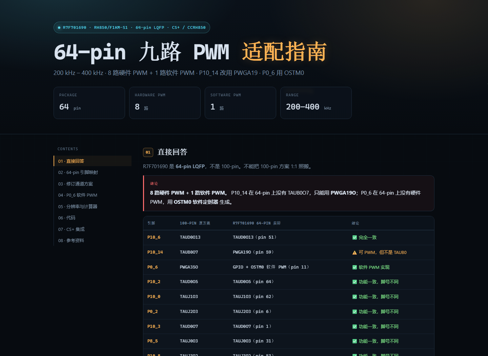

# RH850/F1KM-S1 九路 PWM（R7F701690 / 64-pin）

面向 **R7F701690（RH850/F1KM-S1，64-pin LQFP）** 的九路 PWM 配置指南与 CS+ / CCRH850 驱动。



## 特性

- **8 路硬件 PWM**：TAUD0 / TAUJ，200–400 kHz，频率/占空比独立可调
- **1 路软件 PWM**：P0_6 + OSTM0 free-run compare + INTOSTM0 中断
- **P10_14 使用 PWGA19O**（64-pin 没有 TAUB0O7）
- **交互式 HTML 参数计算器**：输入 PCLK、目标频率、占空比，实时给出 N / CDR / 实际频率 / 误差 / 分辨率
- 完整 `pwm9_64.c` / `pwm9_64.h`，含 CS+ 集成步骤和调试清单
- 保留 100-pin 版本作为参考

## 文件结构

```text
.
├── docs/
│   ├── RH850_R7F701690_64PWM_Guide.html   # 主指南（推荐用浏览器打开）
│   ├── RH850_R7F701690_64PWM_Guide.md
│   └── preview.png
├── src/
│   ├── pwm9_64.c                          # 64-pin 驱动：8 路硬件 + P0_6 软件 PWM
│   ├── pwm9_64.h
│   └── main_pwm_example_64.c
└── reference/
    └── 100pin/                            # 100-pin 旧版，仅作参考
        ├── RH850_F1KM_S1_9PWM_Guide_100pin.html
        ├── RH850_F1KM_S1_9PWM_Guide_100pin.md
        ├── pwm9.c
        ├── pwm9.h
        └── main_pwm_example.c
```

## 快速开始

1. 用浏览器打开 `docs/RH850_R7F701690_64PWM_Guide.html`，先看引脚映射和 P0_6 软件 PWM 章节。
2. 把 `src/pwm9_64.c`、`src/pwm9_64.h` 加入 CS+ 工程，把 `src/main_pwm_example_64.c` 的内容合并到 `main.c`。
3. 在 CS+ / Smart Configurator 中使能：
   - TAUD0、TAUJ0–3
   - PWBA0、PWGA19、PWSA0
   - OSTM0
4. 把 **INTOSTM0** 向量指向 `pwm_sw_isr()`，并给它较高优先级。
5. 调用 `pwm9_init()`，然后用：
   ```c
   pwm9_set_freq_duty(PWM_P10_6, 350000UL, 250U);  /* 350 kHz, 25% */
   pwm9_set_duty(PWM_P10_14, 750U);                /* 只改占空比 */
   ```
6. 按实际时钟树修改 `pwm9_64.h` 里的 `PWM_PCLK_*_HZ` 和 `PWM_SW_PCLK_HZ`。

## 通道分配

| 引脚 | 64-pin 脚号 | 实现 | 时钟 |
|---|---:|---|---|
| P10_2 | 64 | TAUD0 CH4→CH5 | 80 MHz |
| P10_0 | 62 | TAUJ1 CH0→CH3 | 80 MHz |
| P0_2 | 6 | TAUJ2 CH0→CH3 | 40 MHz |
| P10_3 | 1 | TAUD0 CH6→CH7 | 80 MHz |
| P10_14 | 59 | PWGA19 | 40 MHz |
| P8_5 | 31 | TAUJ0 CH0→CH3 | 40 MHz |
| P10_6 | 51 | TAUD0 CH12→CH13 | 80 MHz |
| P10_8 | 53 | TAUJ3 CH0→CH2 | 80 MHz |
| **P0_6** | **11** | **OSTM0 软件 PWM** | **60 MHz** |

## 重要限制

- **P0_6 没有硬件 PWM**。软件 PWM 在 400 kHz 时约 **80 万次中断/秒**，CPU 负载高，抖动取决于 ISR 延迟和优先级。
- P0_6 软件 PWM 建议最大 **400 kHz**；60 MHz OSTM0 下占空比步进约 **0.67%**。
- P10_14 是 PWGA19，40 MHz；400 kHz 时占空比步进约 **1%**。
- 如果允许改板到 **P10_4（TAUD0O9，80 MHz）**，把 `PWM9_USE_P10_4_FOR_P0_6` 设为 `1` 可换回硬件 PWM。

## 参考

- Renesas **RH850/F1KH, RH850/F1KM User's Manual: Hardware**，R01UH0684EJ0130
- 官方页：<https://www.renesas.com/en/document/mah/rh850f1km-rh850f1kh-users-manual-hardware>
- 手册 PDF 因版权/体积未随仓库分发；如需本地查阅，可放到 `reference/manual/`（已在 `.gitignore` 中排除）。
